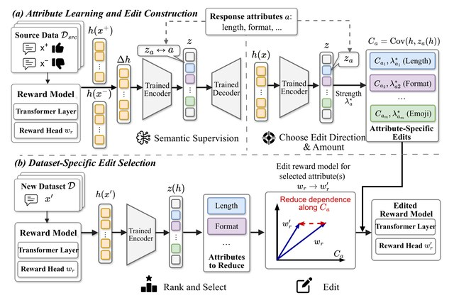
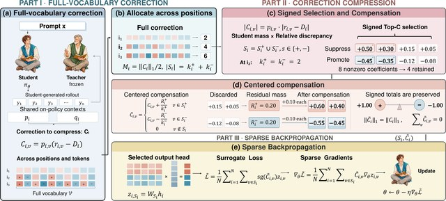
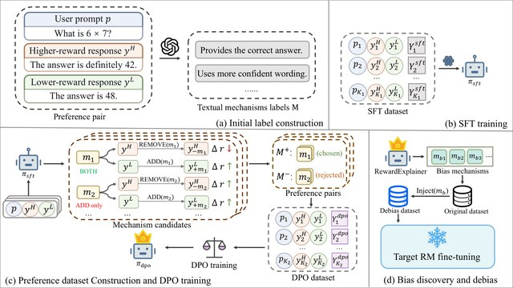
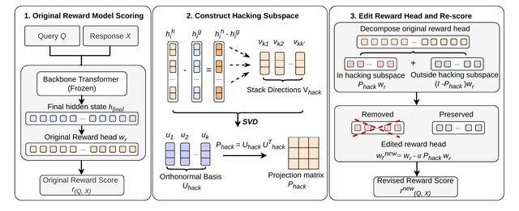
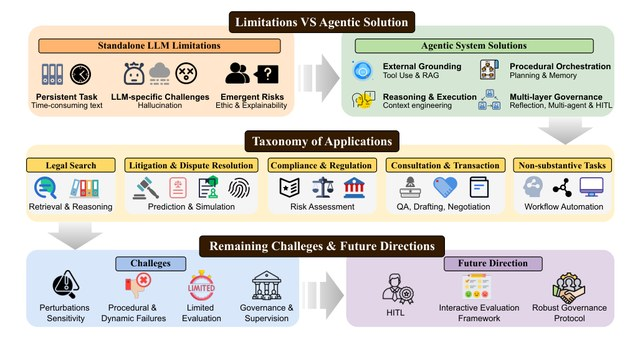
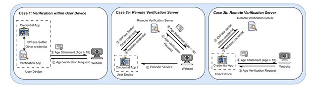
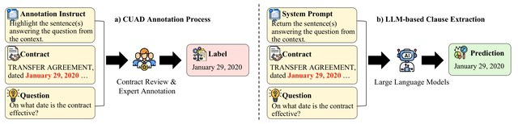
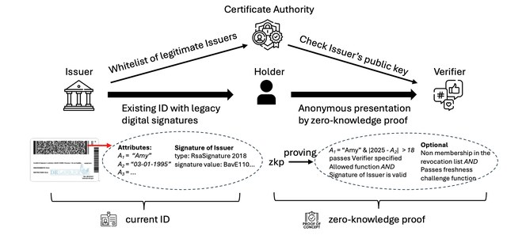
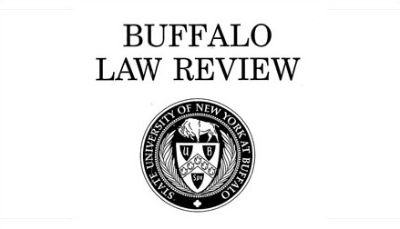

## About Me

I am a third-year Ph.D. student in the School of Computer Science at [Carnegie Mellon University](https://www.cs.cmu.edu/) (CMU), advised by [Sarah Scheffler](https://s3d.cmu.edu/people/core-faculty/scheffler-sarah.html). I am a member of [CyLab](https://www.cylab.cmu.edu/), the security and privacy institute at CMU. Before studying at CMU, I obtained my bachelor's degree from [Tsinghua University](https://www.tsinghua.edu.cn/en/). I went on to earn master's degrees from the [University of Pennsylvania](https://www.upenn.edu/) (M.S. in Computer and Information Technology) and the [University of California, Berkeley](https://www.berkeley.edu/) (LL.M. in Technology and Law).

## Research Interest

Reward modeling and RLHF robustness; LLM post-training and alignment; LLM evaluation and agents (benchmarks and user simulation); synthetic data generation; trustworthy and responsible AI; ML privacy and safety; AI governance and legal AI.

## Publications

### *Preprints*

  

    
    arXiv 2026
  

  

    
<a href="https://arxiv.org/abs/2609.32720">BiasReducer: Adaptive Bias Mitigation for Reward Models</a>

    
<strong>Shuang Liu</strong>, Yongliang Miao, Yanguang Liu, Haoyi Xiong, and Mengnan Du

    
arXiv preprint, 2026

    

      <a href="https://arxiv.org/abs/2609.32720">Paper</a>
    

  

  

    
    arXiv 2026
  

  

    
<a href="https://arxiv.org/abs/2609.34386">Look Before You Select: Rethinking Vocabulary Sparsification in On-Policy Distillation</a>

    
Yongliang Miao, <strong>Shuang Liu</strong>, Yanguang Liu, Yandong Bai, and Mengnan Du

    
arXiv preprint, 2026

    

      <a href="https://arxiv.org/abs/2609.34386">Paper</a>
    

  

  

    
    arXiv 2026
  

  

    
<a href="https://arxiv.org/abs/2609.33989">RewardExplainer: Learning Reward Model Explanations from Counterfactual Preference Feedback</a>

    
Jingyi He, Nier Wu, <strong>Shuang Liu</strong>, Xin Wang, Mengnan Du, and Xia Hu

    
arXiv preprint, 2026

    

      <a href="https://arxiv.org/abs/2609.33989">Paper</a>
    

  

### *Conference Papers*

  

    
    EMNLP 2026
  

  

    
<a href="https://arxiv.org/abs/2606.03131">HARVE: Hacking-Aware Reward-Head Vector Editing for Robust Reward Models</a>

    
<strong>Shuang Liu</strong>, Yuxuan Bo, Qiuyang Zhao, Caiyue Huang, Xiaorong Chen, Yanguang Liu, and Mengnan Du

    
The 2026 Conference on Empirical Methods in Natural Language Processing (EMNLP 2026), Main Conference

    

      <a href="https://arxiv.org/abs/2606.03131">Paper</a>
      <a href="https://github.com/olivialiu121/HARVE-Reward-Head-Editing">Code</a>
    

  

  

    
    ACL 2026
  

  

    
<a href="https://arxiv.org/pdf/2601.06216">LLM Agents in Law: Taxonomy, Applications, and Challenges</a>

    
<strong>Shuang Liu</strong>, Ruijia Zhang, Ruoyun Ma, Yujia Deng, Lanyi Zhu, Jiayu Li, Zelong Li, Zhibin Shen, and Mengnan Du

    
Annual Meeting of the Association for Computational Linguistics (ACL), 2026 (Main Conference)

    

      <a href="https://arxiv.org/pdf/2601.06216">Paper</a>
    

  

  

    
    CSLAW 2026
  

  

    
<a href="https://arxiv.org/pdf/2601.20241">Adequately Tailoring Age Verification Regulations</a>

    
<strong>Shuang Liu</strong> and Sarah Scheffler

    
The ACM Symposium on Computer Science and Law, 2026

    

      <a href="https://arxiv.org/pdf/2601.20241">Paper</a>
    

  

  

    
    NLLP 2025
  

  

    
<a href="https://arxiv.org/pdf/2508.03080">ContractEval: Benchmarking LLMs for Legal Risk Identification in Commercial Contracts</a>

    
<strong>Shuang Liu</strong>, Zelong Li, Ruoyun Ma, Haiyan Zhao, and Mengnan Du

    
The 7th Workshop on Natural Legal Language Processing, 2025

    
🏆 Best Presentation Award

    

      <a href="https://arxiv.org/pdf/2508.03080">Paper</a>
      <a href="https://github.com/olivialiu121/ContractEval">Code</a>
    

  

  

    
    ConPro 2025
  

  

    
<a href="https://conpro25.ieee-security.org/papers/liu-conpro25.pdf">Privacy-preserving Age Verification based on Improved Verifiable Credentials Framework</a>

    
<strong>Shuang Liu</strong> and Sarah Scheffler

    
9th Workshop on Technology and Consumer Protection (ConPro ’25), 2025

    

      <a href="https://conpro25.ieee-security.org/papers/liu-conpro25.pdf">Paper</a>
    

  

### *Journal Articles*

  

    
  

  

    
<a href="https://papers.ssrn.com/sol3/papers.cfm?abstract_id=5976654">Deepfake &amp; Deepfaith</a>

    
Jiawei Zhang* and <strong>Shuang Liu*</strong> (*equal contribution)

    
Buffalo Law Review, 2026

    

      <a href="https://papers.ssrn.com/sol3/papers.cfm?abstract_id=5976654">Paper</a>
    

  

## Recent Talks

- **Natural Legal Language Processing (NLLP) Workshop** — November 8, 2025  
  *ContractEval: Benchmarking LLMs for Clause-Level Legal Risk Identification in Commercial Contracts*

- **9th Workshop on Technology and Consumer Protection (ConPro '25)** — May 15, 2025  
  *Privacy-preserving Age Verification based on Improved Verifiable Credentials Framework*
